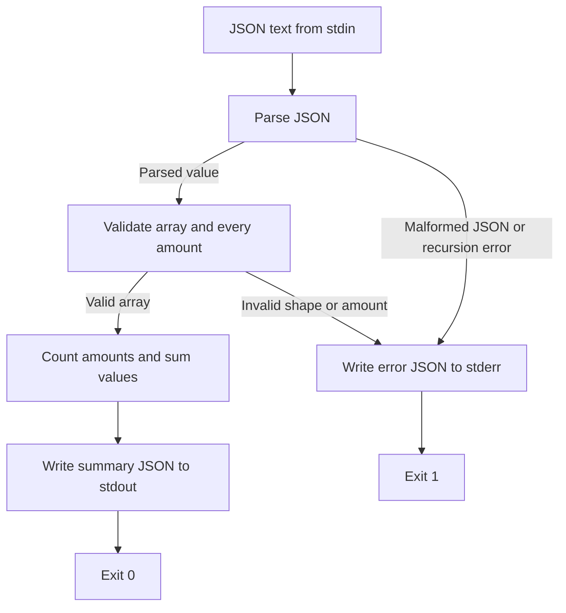

# Summarizing integer amounts

The [summarizer](input/summarize.py) is a single Python process that reads a JSON array from stdin and writes the number of amounts and their total as JSON to stdout. Each amount must be a non-negative integer; booleans, fractional numbers, strings, and negative integers are rejected. An empty array is accepted and produces a count and total of zero.

Arrows show execution flow within that process. The boxes are operations, not separate services.

For `[12, 8, 0]`, parsing creates a Python list, validation accepts all three integers, and aggregation returns `{"count": 3, "total": 20}`. Parsing JSON alone is insufficient: `[12, -1]` is valid JSON but fails the domain check before aggregation. The exact integer check also rejects JSON `true`, even though Python otherwise treats booleans as integers in many contexts.

`main()` owns stdin/stdout, JSON conversion, and the exit code. `summarize()` owns array and amount validation and computes the result. On caught errors, `main()` writes an `error` object to stderr, leaves stdout empty, and exits with status 1. Callers should check the exit status and read stderr for diagnostics. Unexpected exceptions such as I/O failures are not converted into this error response.

This fixture has no persistence, network calls, currency units, or downstream acceptance step. The result establishes a count and arithmetic total of the accepted values. It does not establish the business validity of an amount.
